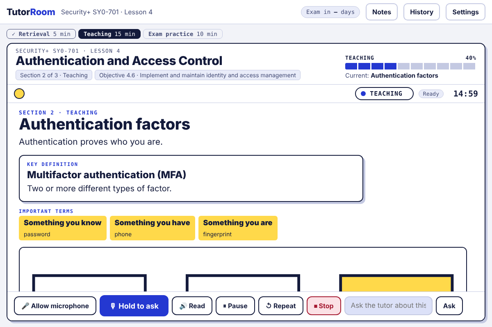
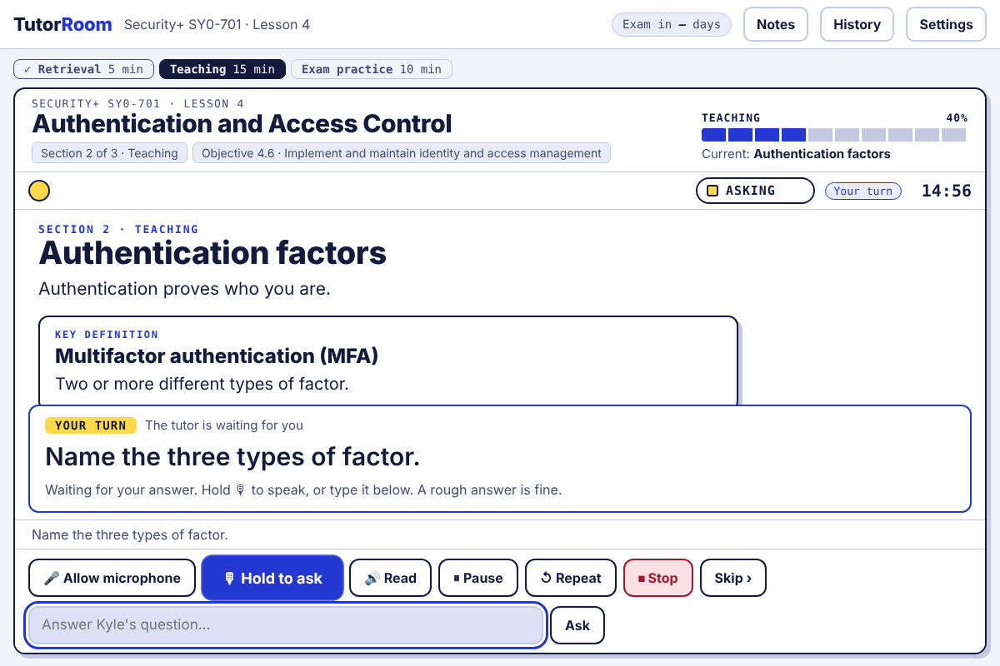
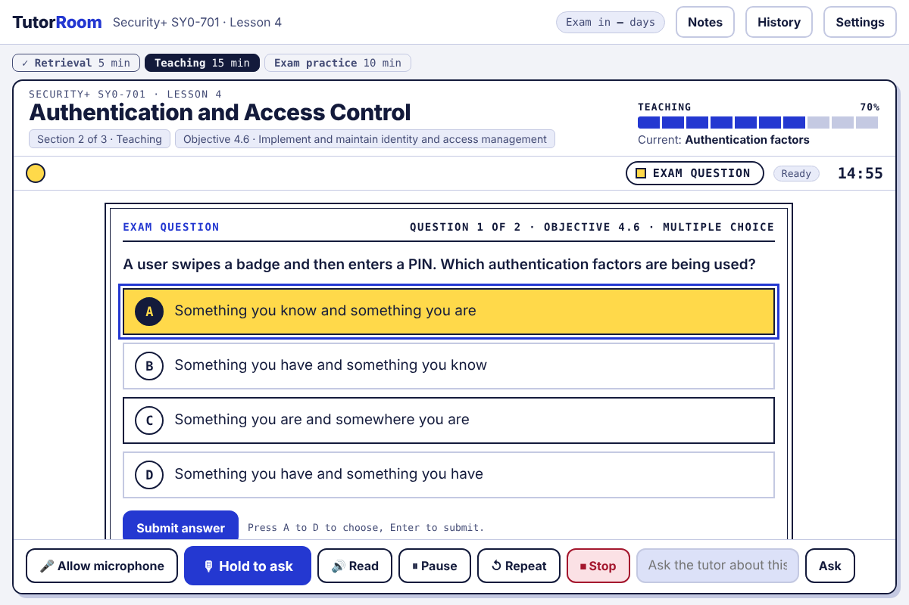
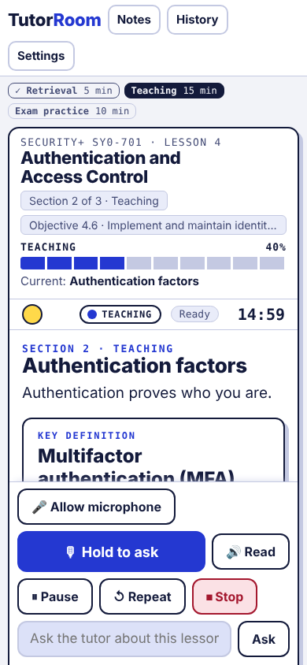
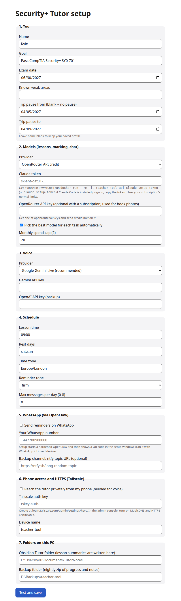
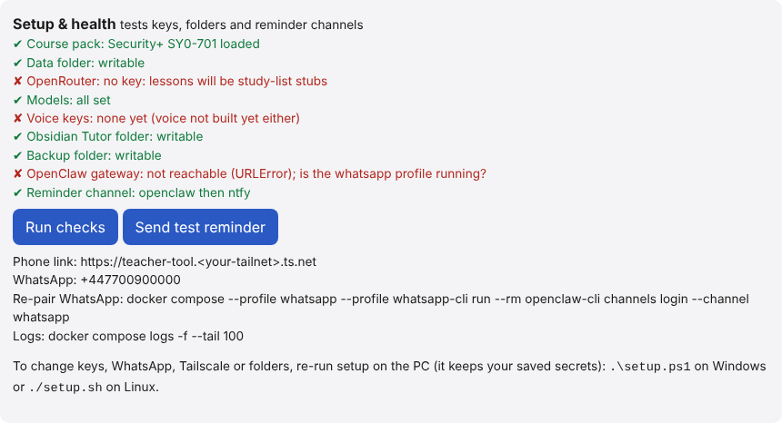
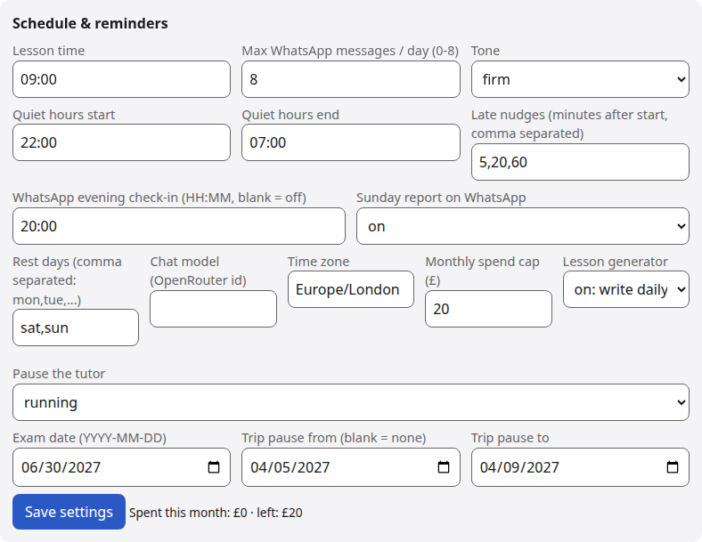
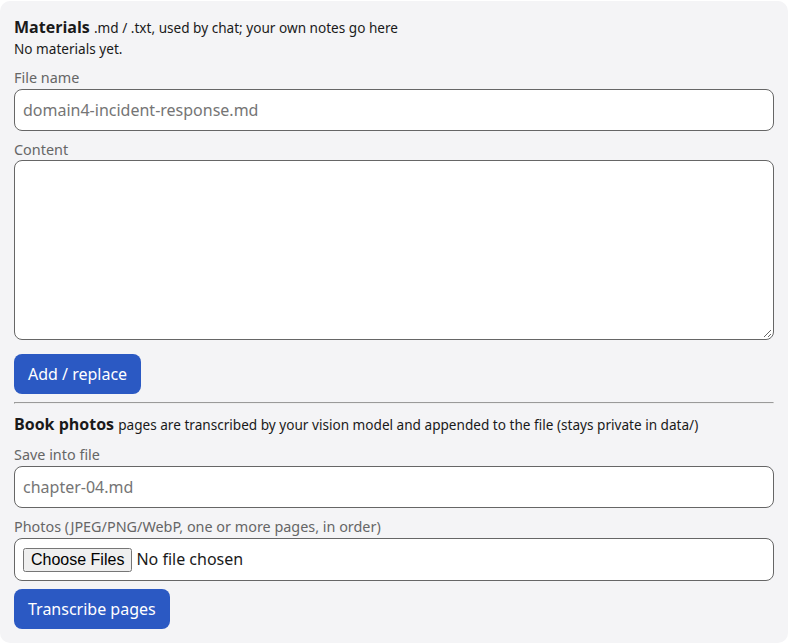

# Teacher Tool

A self-hosted tutor for the CompTIA Security+ exam (SY0-701). It runs on your own computer, teaches one lesson a day out loud, waits while you answer, and marks exam-style questions without sending the answer key to the browser.

I built it while studying for Security+. I passed, and I am working toward a SOC analyst role. The course pack, the schedule, and the tutor's voice are all things you can change. Progress, notes, and recordings stay on the machine that runs it.

## Features

- **Classroom page.** One lesson at a time: the tutor speaks, the key points appear on screen, then it stops and waits. You answer by typing or by holding the microphone button.
- **Exam-style questions.** Multiple choice in the same shape as the exam. The server marks them. A wrong answer is explained, and weak objectives come back later.
- **Progress.** Every answer is stored against the exam objective it belongs to, so the next lesson can use what you missed.
- **Nightly writer and reminders.** A scheduler writes the next lesson, reminds you before it, nudges you if you are late, and marks the day missed if you never start. Rest days, a pause range, and a daily message cap are settings.
- **Optional WhatsApp reminders.** If you turn them on, reminders, an evening check-in, and a Sunday report go to your own number. Replies such as `status`, `move 19:00`, `skip`, `quiz`, and `help` are answered from the tutor's data. Group chats are ignored.
- **Local voice.** Speech-to-text is local (faster-whisper). Speech-out is local Kokoro, with Piper as a fallback and the browser voice as a last resort. Gemini speech is optional.
- **Admin.** Tutor personality ("soul"), your study context, the schedule, reminder rules, a monthly spend cap, and your own notes. Book-page photos can be transcribed into private materials.
- **Notebook.** A notes drawer on the lesson page, stored on the server with an offline cache in the browser.
- **Setup.** `setup.ps1` or `setup.sh` asks a few questions, writes `.env`, installs the speech models, starts the containers, and runs a self-test.

## Screenshots

| Teaching | Your turn | Exam question |
|---|---|---|
|  |  |  |

The same lesson on a phone (Tailscale gives the page HTTPS, which the microphone needs):



Setup and admin:

| Setup | Health | Schedule | Materials |
|---|---|---|---|
|  |  |  |  |

## Tech stack

- Python standard-library HTTP server and a SQLite store. No web framework.
- Plain HTML and JavaScript for the classroom and admin pages. No build step. Light, dark, and auto themes.
- Docker Compose. The API and scheduler containers are read-only, drop all capabilities, and publish only on localhost.
- One model gateway (`LLM.complete` / `LLM.stream`). Lessons can use a Claude Pro/Max subscription through `claude -p`, or OpenRouter. A monthly spend cap stops further calls.
- Optional [OpenClaw](docs/OPENCLAW.md) container for WhatsApp, locked to a messaging tool profile, and an optional Tailscale sidecar for a private HTTPS link.

## Run it

You need Docker, Git, and either a Claude Pro/Max subscription or an [OpenRouter](https://openrouter.ai/keys) key with a credit limit. WhatsApp and Tailscale are optional.

**Windows** (Docker Desktop running):

```powershell
git clone https://github.com/MrKnight28/teacher-tool
cd teacher-tool
powershell -ExecutionPolicy Bypass -File .\setup.ps1
```

**Linux or macOS:**

```sh
git clone https://github.com/MrKnight28/teacher-tool
cd teacher-tool
./setup.sh
```

Then open http://127.0.0.1:8080. The access token is written to `.env` as `TUTOR_TOKEN` and is not printed. Admin is at `/admin`. Later updates: `.\update.ps1` on Windows.

Full steps, WhatsApp pairing, and the troubleshooting table: [docs/INSTALL.md](docs/INSTALL.md).

To look around with no model and nothing recorded, open `http://127.0.0.1:8080/?mock=1` after the server is up, or install the practice lesson:

```powershell
docker compose exec api python3 -m tutor sample-lesson
```

### Configuration

Secrets are environment variables. Copy [`.env.example`](.env.example) to `.env` if you are not using setup. Setup keeps saved secrets when you run it again. Do not commit `.env`, `data/`, `openclaw/`, or `tailscale/`.

### Tests

```sh
cd apps/api && pip install -e .[dev] && PYTHONPATH=. python3 -m pytest -q
```

Browser checks (Node, Playwright): `cd apps/api/tests/browser && npm install && npm test`.

## What I learned

- A tutor that can see your notes has to treat those notes, chat, and lesson text as data. The prompts fence that text, and the answer key never goes to the browser or into the chat model.
- One gateway for every model call is what makes a monthly spend cap real. Providers are not called from the rest of the app.
- Speech can stay on the machine. The microphone path uses a local model, and the page only needs localhost or HTTPS before the browser will allow the mic.
- The server refuses to listen beyond localhost unless a long random token is set, and that token is compared in constant time. The containers drop every capability.
- The same Compose file has to survive Windows Docker Desktop: paths with spaces, CRLF checkouts, and a port that is already taken.

## Course pack

`packs/security-plus-sy0-701/` is the Security+ SY0-701 pack: objectives, a tutor "soul", a practice lesson, and course lessons. The exam date, pause, and lesson start in `pack.yaml` are examples. Setup and the admin page override them, and the monthly spend cap is a number you choose there. Check the objectives against the official CompTIA PDF before you rely on them. Quiz questions are model-written; spot-check them. What is not built yet: [docs/ROADMAP.md](docs/ROADMAP.md).

Voice model licences, including a research-only Piper voice, are recorded in [LICENSES.md](LICENSES.md). Security notes: [docs/SECURITY.md](docs/SECURITY.md).

## Author

Kyle Knight. Aspiring SOC analyst. CompTIA Security+.
