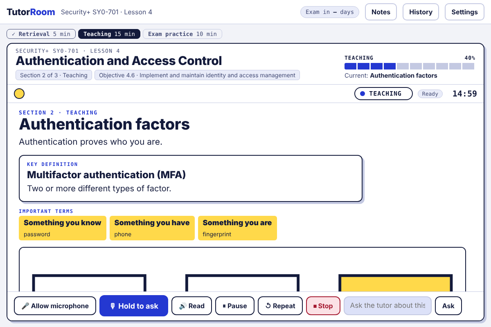
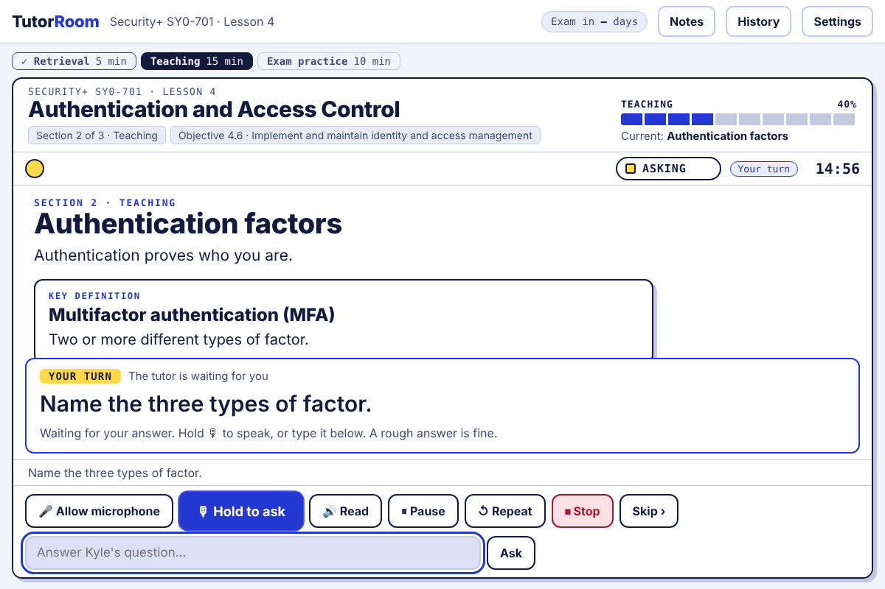
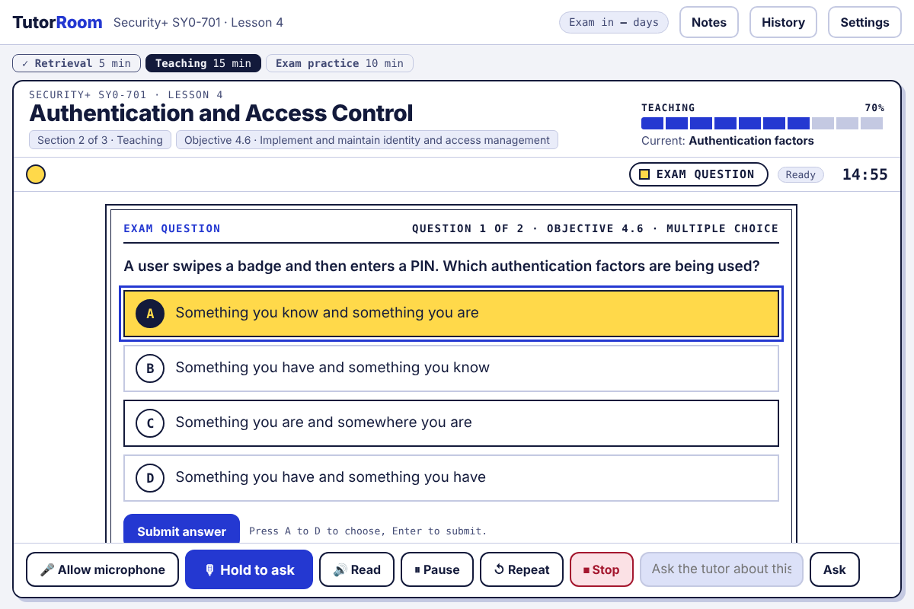
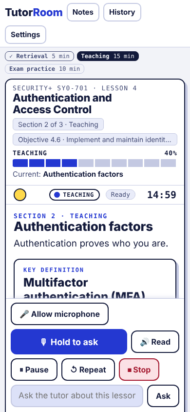
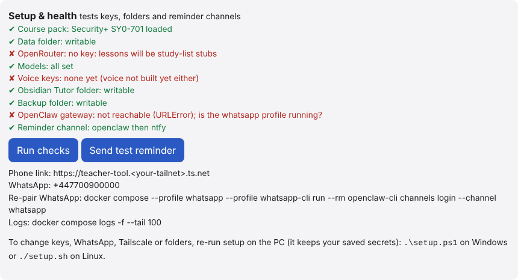

# Install guide

Set up the Security+ Tutor on a Windows PC in about 15 minutes, most of it waiting for downloads. (Linux/macOS: use `./setup.sh`.)

## You need

| | |
|---|---|
| **Docker Desktop** | `winget install -e --id Docker.DockerDesktop`, start it, wait for "Engine running" |
| **Git** | `winget install -e --id Git.Git` |
| **A way to run the model** | Claude Pro subscription (recommended) or an [OpenRouter key](https://openrouter.ai/keys) with a credit limit set |
| *Optional* | WhatsApp for reminders, Tailscale for your phone and HTTPS (needed for the microphone) |

## 1. Download

```powershell
cd $HOME
git clone https://github.com/MrKnight28/teacher-tool
cd teacher-tool
```

## 2. Run setup

```powershell
powershell -ExecutionPolicy Bypass -File .\setup.ps1
```

Answer the questions in the window (Enter keeps the value in brackets). Setup:

1. checks Docker and builds the tutor,
2. asks how to reach Claude, your name, exam date, lesson time and monthly spend cap,
3. asks whether you want WhatsApp reminders (see below),
4. installs the local speech models (Whisper in, Kokoro/Piper out) and checks each one works,
5. starts the tutor and scheduler, runs a self-test and opens the tutor.

Secrets are never printed. Your access token is saved as `TUTOR_TOKEN` in `.env`.
**Re-running setup is safe**: it keeps everything you don't change.


## 3. Open it

Go to **http://127.0.0.1:8080**, paste your access token, press **Start lesson**. Admin is at `/admin`.



The tutor teaches aloud and moves on by itself. When it asks a question it stops and waits for you.
Hold the mic button to speak, or type.



Exam questions come at the end. Click an answer or press A to D, then Enter. Wrong answers come back in later lessons.



It works on a phone too (with Tailscale).



**Setup & health** in admin re-runs every check and sends a test reminder.



No lessons yet? Try the practice lesson (nothing is recorded):

```powershell
docker compose exec api python3 -m tutor sample-lesson
```

## WhatsApp reminders (optional)

The tutor keeps you accountable on WhatsApp:
- a reminder 15 minutes before the lesson, nudges at 5 and 20 minutes late, and "missed" after an hour,
- an evening check-in (20:00): lesson done or not, and your streak of study days,
- a Sunday report: lessons done, exam questions right, weakest topics, next week's lessons.

Reply to it any time: `status`, `move 19:00` (today only), `skip`, `quiz` (then A to D), `help`.
It links to your own WhatsApp like WhatsApp Web does, and only your number gets an answer. Replies come from the
tutor's own data, not an AI, so they cost nothing. Times, tone and the daily message limit are on the admin page.

Setup asks **"Send reminders on WhatsApp?"**. Say `y`, then:

1. type your number in international format (`+447700900000`),
2. paste an OpenRouter key if setup asks for one. The WhatsApp messenger needs a small model of its own, even if lessons
   use your Claude subscription. The free models are enough,
3. when setup finishes, a QR code appears. On your phone: **WhatsApp > Settings > Linked devices > Link a device**, and
   scan it. A test message arrives when it works.

Already installed? Run `.\setup.ps1` again and answer `y` at the WhatsApp question.
To turn it off, run setup again and answer `n`. Details: [OPENCLAW.md](OPENCLAW.md).

## Update

```powershell
.\update.ps1
```

It pulls the latest code and rebuilds. Then press **Ctrl+F5** in the browser.

## Change things later

- **Schedule, tone, cap, notes:** the admin page, saved instantly.
- **Keys, WhatsApp:** run `.\setup.ps1` again.
- **Tailscale, Obsidian and backup folders:** `docker compose --profile setup-browser run --rm -p 127.0.0.1:8090:8090 wizard`, open the address it prints (it ends with `?k=` and a one-time key; the form refuses anything without it), save, then `.\setup.ps1`.
- **Re-pair WhatsApp:** `docker compose --profile whatsapp --profile whatsapp-cli run --rm openclaw-cli channels login --channel whatsapp`

## If something goes wrong

| Problem | Fix |
|---|---|
| "Docker Desktop is installed but not running" | Start Docker Desktop, wait for "Engine running", re-run setup |
| Port 8080 already in use | Close what uses it, or change the left-hand port in `docker-compose.yml` |
| Lessons say "offline stub" | No Claude or OpenRouter access, or the spend cap was reached: check admin > Setup & health |
| Microphone blocked | Browsers need `127.0.0.1` or HTTPS; on a phone use the Tailscale link |
| Reminders only in the logs | WhatsApp isn't on: run `.\setup.ps1` and answer `y` at the WhatsApp question |
| See what's happening | `docker compose logs -f --tail 100` |

## Uninstall

```powershell
docker compose --profile whatsapp --profile tailscale down
```

Then delete the folder. Your data is in `data/` and the backup folder you chose.
